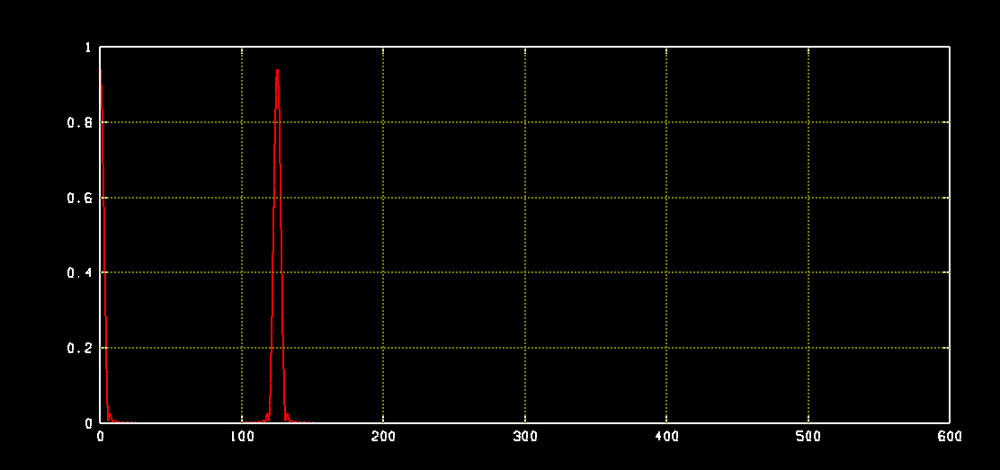
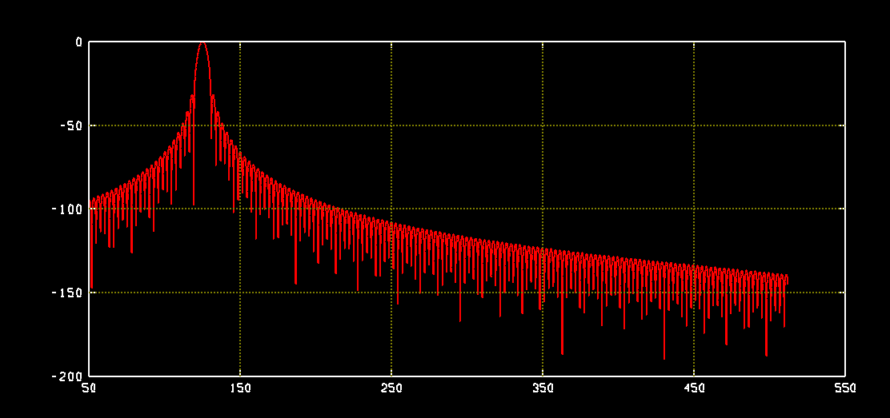

# fftp - an X11 spectrum analyzer for ASCII data

Fftp(1) is a program for generating Fourier spectra from evenly sampled
real and complex ASCII data sets.  Fftp(1) will perform Welch's
smoothing method on large data files and optionally use the Chirp Z
Transform to efficiently zoom into portions of the frequency spectrum. 

Fffp(1) is a classic command-line UNIX program.  Fftp(1) handles
windowing, conversion to single-sided spectrum, and DC-level
correction/nulling.  Many hours of corner case testing has been done to
ensure that when you need an FFT, you can quickly get an accurate
analysis without having to open up a textbook. 

Fftp(1) outputs the resulting spectrum-analyzer data as an ASCII file
ready for plotting in pdplot, gnuplot, or other graphing package.

FFtp(1) is self-contained, using only stdio.h, stdlib.h and math.h.  Just
type "make" and then "make install".

   In the examples below, the program pd(1) refers to the pdplot(1)  plot‐
   ting program which takes ASCII x,y floating point numbers, one pair per
   line,  and plots them in an X11 window with autoscaled axes.  Any other
   ascii plot package, such as gnuplot(1), could be substituted with minor
   changes to the script.

   A sinusoid signal at 125Hz with a dc component of 1V can  be  generated
   and analyzed as follows.

       awk '
         BEGIN {
         OFMT="%.12g"
         for (t=0; t<5; t+=1/1024) {
           print t, 1+sqrt(2)*sin(6.2832*125*t)
         }
       }' | fftp -1 -whan -n350 -p8 | pd

   Complex  input  data  such  as the following, resulting from quadrature
   mixing of a single-sideband signal, yields  an  asymmetrical  two-sided
   spectrum.

       awk '
         BEGIN {
           OFMT="%.12g"
           for (t=0; t<5; t+=1/1024) {
              print t, cos(6.2832*125*t), sin(6.2832*125*t)
           }
       }' | fftp -whan -n350 -p8 | pd

   With  the  -f option, one can zoom in on the desired signal.  Note that
   the resolution of the peak is still limited by the  window  length  se‐
   lected  via  the -n option.  The -dbv option is also introduced in this
   example to enable decibel plots.

       awk '
         BEGIN {
           OFMT="%.12g"
           for (t=0; t<5; t+=1/1024) {
              print t, cos(6.2832*125*t), sin(6.2832*125*t)
           }
       }' | fftp -whan -n350 -p8 -f50@125 -dbv | pd 

   The following example demonstrates the measurement  of  wideband  noise
   using  the  spectral density mode enabled by the option -s.  The gener‐
   ated binary noise sequence has a root-mean-squared value of  1  "Volt".
   Assuming  that  the  noise  is distributed uniformly over the bandwidth
   from zero to the Nyquist frequency of 512Hz, the noise magnitude should
   be 1/sqrt(512) V/sqrt(Hz) or about 44 mV/sqrt(Hz).

       awk '
       BEGIN {
	 OFMT="%.12g"
	 for (t=0; t<250; t+=1/1024)
	   print t, (rand()<0.5) ? -1 : 1
       }' | fftp -1s -n500 -a100 -t | pd

   Use of a Kaiser data window allows one to  resolve  low-level  spectral
   features that can be obscured by the sidelobes of other windows.

       awk '
       BEGIN {
	 OFMT="%.12g"
	 for (t=0; t<25; t+=1/1024)
	   print t, sqrt(2)*sin(800*t)+(sqrt(2)/1e5)*sin(880*t)
       }' | fftp -1 -k120 -n1024 -p8 -dbv | pd

--

Rick Walker
